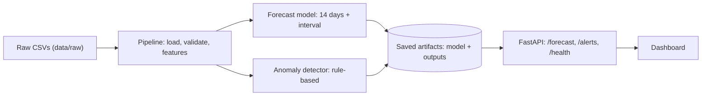

# Architecture

Draft; refined during the dashboard and API work. Last updated 2026-11-20.

## Components

## Batch vs real-time
Batch. The source is a static historical dataset, the forecast horizon is
14 days, and planners review forecasts and alerts daily, so nothing needs
sub-second data freshness. The pipeline runs on demand (and could be
scheduled daily); the API serves precomputed results.

## Expected size, rate, and latency
Assumptions to verify, except where marked as measured.
- Data: 14 CSV tables, 60.2 MB in total (measured); the largest is
  `delivery_events.csv` (170,820 rows).
- Modeling input: one row per day, 1,096 rows.
- Requests: a few planners and analysts, assumed at most tens per day.
- Latency target: under 1 second per request, served from saved outputs
  rather than computed per request.

## Likely bottlenecks
- Rebuilding features from raw CSVs on every run; mitigated by saving
  processed data.
- Saved forecasts and alerts going stale if the pipeline is not rerun.
- Reading artifacts from local disk in a single-process API: fine at this
  scale, not for many users.
- Alert volume: too many false positives would make the alert list unusable.
- Data-quality problems (timestamp order, missing IDs) reaching the
  features without validation checks.